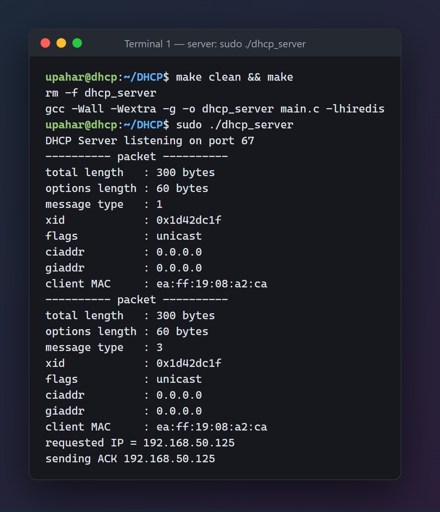
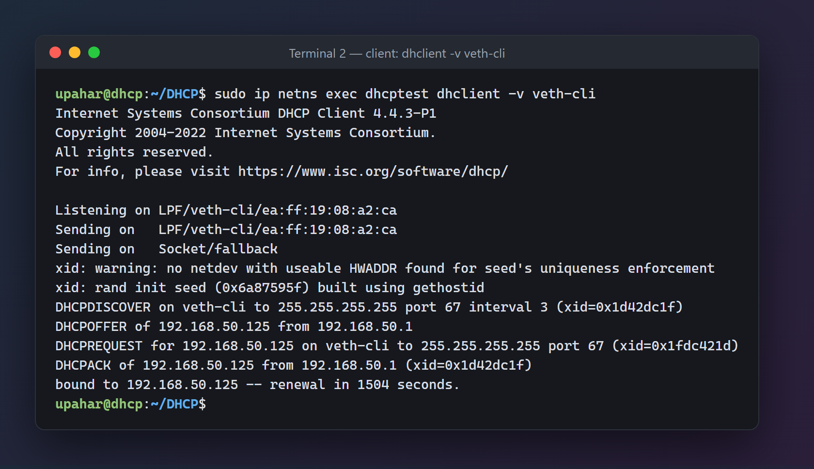
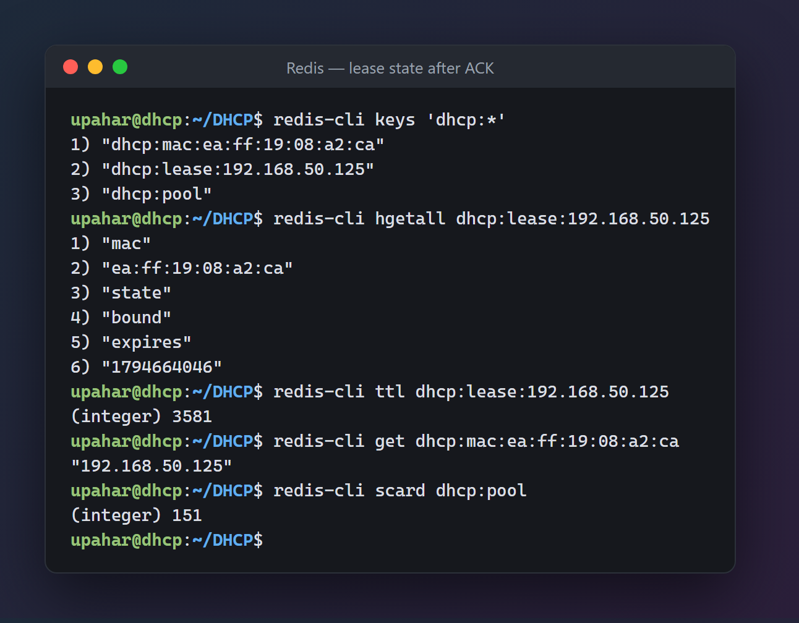
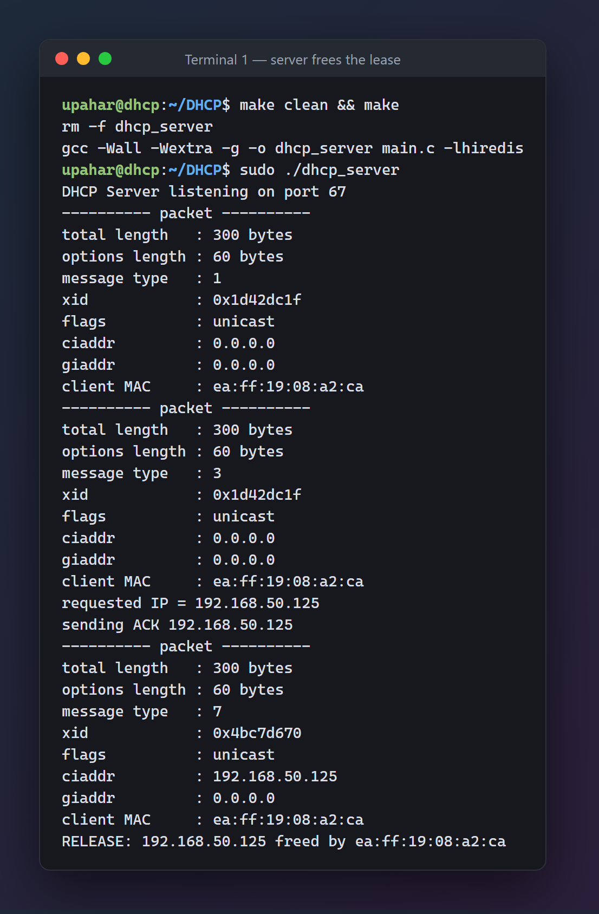
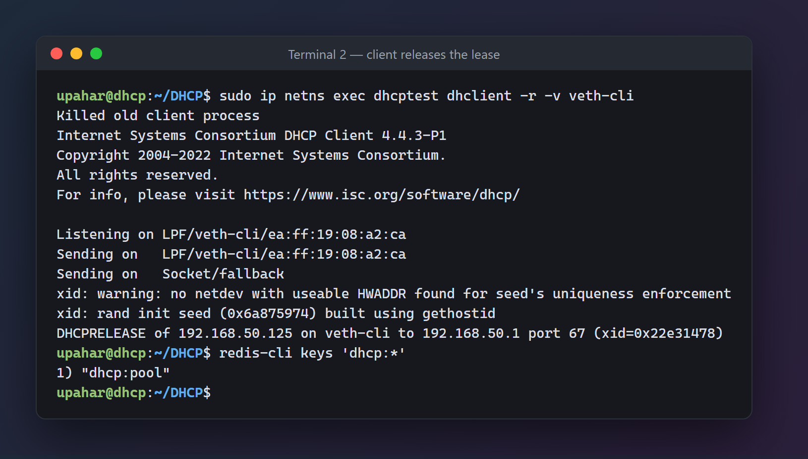

# DHCP Server

A small DHCP server written in C. It listens on UDP port 67, hands out addresses
from a pool, and tracks leases in Redis. It supports the full
Discover → Offer → Request → Ack exchange, plus Release, Decline and NAK.

> Use this only on an isolated test network (a network namespace or VM). A DHCP
> server can disrupt address assignment for other devices on the same network.

## Output

The server and `dhclient` (running in an isolated network namespace) complete the
full Discover → Offer → Request → Ack exchange, and the client is bound to
`192.168.50.125`.

**Terminal 1: the server** logs the DISCOVER (type 1) and REQUEST (type 3) packets
and sends the ACK:



**Terminal 2: the client** gets an OFFER, requests that address and is bound to it:



The lease as stored in Redis after the ACK: owner MAC, `bound` state, expiry and
TTL, plus the MAC → IP mapping used to give a returning client the same address:



Releasing the lease (`dhclient -r`) sends a RELEASE (type 7), and the server frees
the IP:



Both lease keys are then gone from Redis, and only the pool is left:



More screenshots are in [screenshots/](screenshots/).

## Features

- Parses DHCP packets with bounds-checked option walking (never trusts client lengths)
- Address pool and lease tracking stored in Redis
- Same client (same MAC) gets the same IP back when possible
- Atomic IP claiming, so two clients never get the same address
- Automatic lease and offer expiry using Redis TTLs
- Handles `DISCOVER`, `REQUEST` (including renewals), `RELEASE` and `DECLINE`
- Replies with `OFFER`, `ACK` or `NAK`
- Ignores requests addressed to another DHCP server (Server Identifier check)

## How it works

| Client message          | What the server does                                                                                  | Reply                                          |
| ----------------------- | ----------------------------------------------------------------------------------------------------- | ---------------------------------------------- |
| `DHCPDISCOVER`          | Reuses the client's previous IP, or claims a free one from the pool, as an _offer_                    | `DHCPOFFER` (broadcast)                        |
| `DHCPREQUEST`           | Checks the IP is in the pool and not owned by someone else, then turns the offer into a _bound_ lease | `DHCPACK`, or `DHCPNAK` if it can't be granted |
| `DHCPREQUEST` (renewal) | Same as above; the client already has an IP (`ciaddr`), so the ACK is sent to it directly             | `DHCPACK` (unicast)                            |
| `DHCPRELEASE`           | If the sender owns the IP, frees it immediately                                                       | none                                           |
| `DHCPDECLINE`           | If the sender owns the IP, quarantines it so it isn't handed out again for a while                    | none                                           |

Replies carry these options: message type (53), server identifier (54), lease
time (51), subnet mask (1) and router (3). A `NAK` carries only the first two.

## Redis usage

Redis holds all the state, so leases survive a server restart. The code is in
[lease.h](lease.h).

### Keys

| Key               | Type   | Contents                                                                                                |
| ----------------- | ------ | ------------------------------------------------------------------------------------------------------- |
| `dhcp:pool`       | set    | Every IP in the configured range. Seeded once at startup if it doesn't exist, never changed afterwards. |
| `dhcp:lease:<ip>` | hash   | `mac` (owner), `state` (`offered`, `bound` or `declined`), and `expires` (bound leases only).           |
| `dhcp:mac:<mac>`  | string | The IP last given to that client. Lets a returning client get the same address.                         |

An IP is **free** when it is in `dhcp:pool` and has no `dhcp:lease:<ip>` key.
There is no cleanup loop. Every lease key has a TTL, and when it runs out the
IP becomes free again on its own.

| State      | TTL                          |
| ---------- | ---------------------------- |
| `offered`  | `OFFER_TTL` (60 s)           |
| `bound`    | `LEASE_SECS` (3600 s)        |
| `declined` | `DECLINE_QUARANTINE` (600 s) |

### Functions

| Function            | Redis commands                                     | Purpose                                                                                                      |
| ------------------- | -------------------------------------------------- | ------------------------------------------------------------------------------------------------------------ |
| `lease_connect`     | (connect)                                          | Opens the connection to Redis                                                                                |
| `lease_seed_pool`   | `EXISTS`, `SADD`                                   | Fills `dhcp:pool` from `POOL_START` to `POOL_END` if it's empty                                              |
| `lease_find_by_mac` | `GET dhcp:mac:<mac>`                               | Finds the IP a client had before                                                                             |
| `lease_in_pool`     | `SISMEMBER`                                        | Checks an IP belongs to our pool                                                                             |
| `lease_get_owner`   | `HGET dhcp:lease:<ip> mac`                         | Finds out who holds an IP                                                                                    |
| `lease_try_claim`   | `HSETNX`                                           | Atomically claims an IP. Only one client can win, so no double allocation.                                   |
| `lease_allocate`    | `SMEMBERS`, `HSETNX`, `HSET`, `EXPIRE`, `SET … EX` | On Discover: reuse the client's old IP if it still owns it, otherwise claim a free one and mark it `offered` |
| `lease_commit`      | `SISMEMBER`, `HGET`, `HSET`, `EXPIRE`, `SET … EX`  | On Request: verify the IP and owner, mark it `bound` and set the full lease TTL                              |
| `lease_release`     | `DEL` (both keys)                                  | On Release: frees the IP in one atomic command                                                               |
| `lease_decline`     | `MULTI`, `DEL`, `HSET`, `EXPIRE`, `EXEC`           | On Decline: marks the IP `declined` with owner `declined`, so it can't be claimed until the quarantine ends  |

### Lease lifecycle

```
free ──Discover──► offered ──Request──► bound ──expiry / Release──► free
                      │                   │
                  60 s timeout        Decline
                      ▼                   ▼
                    free              declined ──10 min──► free
```

## Build and run

### Prerequisites

- Linux with `gcc` and `make`
- hiredis development headers: `sudo apt install libhiredis-dev`
- Docker (for Redis)
- `iproute2` (for network namespaces) and `isc-dhcp-client` (provides `dhclient`)

### 1. Start Redis

```sh
docker run -d --name dhcp-redis -p 6379:6379 redis
```

The server connects to `127.0.0.1:6379`.

### 2. Create an isolated test network

The server binds to the interface `veth-srv`. The client runs inside a separate
network namespace so it can't touch your real network.

```sh
sudo ip netns add dhcptest
sudo ip link add veth-srv type veth peer name veth-cli
sudo ip link set veth-cli netns dhcptest

sudo ip addr add 192.168.50.1/24 dev veth-srv
sudo ip link set veth-srv up

sudo ip netns exec dhcptest ip link set lo up
sudo ip netns exec dhcptest ip link set veth-cli up
```

### 3. Build and start the server

```sh
make
sudo ./dhcp_server        # or: make run
```

Port 67 is privileged, so the server needs `sudo`. You should see
`DHCP Server listening on port 67`.

If a host firewall such as `ufw` is enabled, it drops the client's broadcast
before it reaches the server (the client keeps repeating `DHCPDISCOVER` and the
server prints nothing). Allow traffic on the test interface:

```sh
sudo iptables -I INPUT -i veth-srv -j ACCEPT
```

### 4. Get a lease from the test client

In another terminal:

```sh
sudo ip netns exec dhcptest dhclient -v veth-cli
```

You should see the Discover, Offer, Request and Ack exchange, ending with
`bound to 192.168.50.x`.

### 5. Inspect and test

```sh
# see the leases the server created
docker exec dhcp-redis redis-cli keys 'dhcp:*'
docker exec dhcp-redis redis-cli hgetall dhcp:lease:192.168.50.100
docker exec dhcp-redis redis-cli ttl dhcp:lease:192.168.50.100

# release the lease; both lease keys should disappear
sudo ip netns exec dhcptest dhclient -r -v veth-cli

# watch the traffic
sudo ip netns exec dhcptest tcpdump -ni veth-cli port 67 or port 68
```

### Reset

```sh
# clear all server state (restart the server afterwards so the pool is re-seeded)
docker exec dhcp-redis redis-cli FLUSHALL

# clear the client side
sudo ip netns exec dhcptest ip addr flush dev veth-cli
sudo rm -f /var/lib/dhcp/dhclient.leases
```

### Clean up

```sh
make clean
sudo ip netns del dhcptest      # also removes veth-cli and its peer
docker rm -f dhcp-redis
```

## Configuration

These are compile-time constants for now:

| Setting              | File                                           | Default                   |
| -------------------- | ---------------------------------------------- | ------------------------- |
| Server IP and router | [dhcp.h](dhcp.h) `SERVER_IP`                   | `192.168.50.1`            |
| Subnet mask          | [dhcp.h](dhcp.h) `SUBNET_MASK`                 | `255.255.255.0`           |
| Lease time           | [dhcp.h](dhcp.h) `LEASE_SECS`                  | `3600`                    |
| Address pool         | [lease.h](lease.h) `POOL_START` / `POOL_END`   | `192.168.50.50` – `.200`  |
| Offer hold time      | [lease.h](lease.h) `OFFER_TTL`                 | `60`                      |
| Decline quarantine   | [lease.h](lease.h) `DECLINE_QUARANTINE`        | `600`                     |
| Redis address        | [lease.h](lease.h) `REDIS_HOST` / `REDIS_PORT` | `127.0.0.1:6379`          |
| Network interface    | [server.h](server.h) `create_socket`           | `veth-srv`                |

## DHCP packet format

DHCP is built on BOOTP: a fixed header followed by variable-length options.
Numeric fields are in network byte order, and the transaction ID (`xid`) ties a
reply to its request.

| Field     |      Size | Meaning                                                              |
| --------- | --------: | -------------------------------------------------------------------- |
| `op`      |    1 byte | `1` (`BOOTREQUEST`) from a client or `2` (`BOOTREPLY`) from a server |
| `htype`   |    1 byte | Hardware address type (`1` = Ethernet)                               |
| `hlen`    |    1 byte | Hardware address length (`6` for Ethernet)                           |
| `hops`    |    1 byte | Relay-agent hop count                                                |
| `xid`     |   4 bytes | Random transaction ID                                                |
| `secs`    |   2 bytes | Seconds since the client began acquiring or renewing                 |
| `flags`   |   2 bytes | Client flags (the broadcast bit asks for a broadcast reply)          |
| `ciaddr`  |   4 bytes | Client address, set when the client already has a usable IP          |
| `yiaddr`  |   4 bytes | "Your" address, offered or assigned by the server                    |
| `siaddr`  |   4 bytes | Next bootstrap server                                                |
| `giaddr`  |   4 bytes | Relay agent address (nonzero when relayed)                           |
| `chaddr`  |  16 bytes | Client hardware address (MAC plus padding)                           |
| `sname`   |  64 bytes | Optional server host name                                            |
| `file`    | 128 bytes | Boot file name                                                       |
| `options` |  variable | Options, after the 4-byte magic cookie `63 82 53 63`                 |

The fixed BOOTP portion is 236 bytes. With the magic cookie, `DHCP_HDR_LEN` is 240.

Each option is a one-byte code, a one-byte length and the value. Code `0` is
padding and `255` ends the list.

| Code | Name                        |
| ---: | --------------------------- |
|  `1` | Subnet Mask                 |
|  `3` | Router                      |
|  `6` | DNS (defined, not sent yet) |
| `50` | Requested IP Address        |
| `51` | IP Address Lease Time       |
| `53` | DHCP Message Type           |
| `54` | DHCP Server Identifier      |
| `55` | Parameter Request List      |
| `61` | Client Identifier           |

## Project files

- [main.c](main.c): receive loop and message handling
- [dhcp.h](dhcp.h): constants, option and message-type enums, packet header struct
- [server.h](server.h): socket setup, option parsing, reply building
- [lease.h](lease.h): all Redis lease and pool logic
- [Makefile](Makefile): `make`, `make run`, `make clean`

## References

- [RFC 2131: Dynamic Host Configuration Protocol](https://datatracker.ietf.org/doc/html/rfc2131)
- [RFC 2132: DHCP Options and BOOTP Vendor Extensions](https://datatracker.ietf.org/doc/html/rfc2132)
